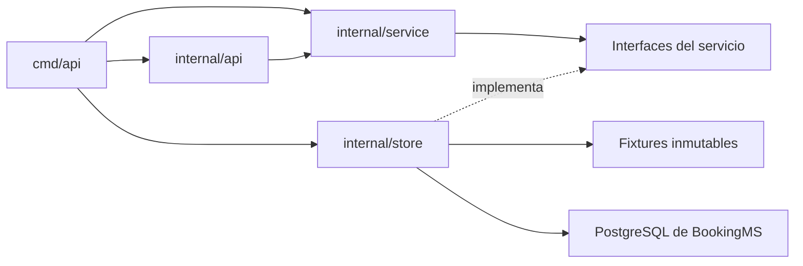

# Backend de reservas

BookingMS expone las 14 operaciones del Hito 1 con datos simulados. El ejecutable Go vive en `cmd/api`. El contenedor definido en `Dockerfile.migrate` ejecuta Goose directamente.

## Capas

- **Handler:** enruta, valida la entrada HTTP y traduce resultados y fallas a OpenAPI.
- **Service:** decide escenarios, filtra, pagina y recorta disponibilidades. Declara las interfaces para leer datos y consultar disponibilidad de la base.
- **Store:** carga fixtures y los ofrece por interfaces de solo lectura. Su adaptador PostgreSQL comprueba la conexión de `/readyz`.
- **Tipos:** `internal/service/domain` contiene el modelo del dominio. `internal/service/demo` reúne los datos de lectura compartidos con el store y el transporte. El punto de entrada inyecta los adaptadores.

## Propiedad de datos y dependencias

| Dato                                                           | Responsable          | Uso actual                                               |
| -------------------------------------------------------------- | -------------------- | -------------------------------------------------------- |
| Reservas, recursos reservables, horarios, bloqueos y políticas | Agenda (BookingMS)   | Los fixtures simulan lecturas y respuestas de escritura. |
| Envío del correo de confirmación de una nueva reserva          | Notificaciones (G10) | Agenda registra una simulación del envío en consola.     |

Notificaciones es la única dependencia directa de Agenda según el documento de componentes de la sección. La demo usa actores simulados y el catálogo reservable de Agenda admite una referencia externa opcional. PostgreSQL es de uso exclusivo de Agenda.

El cliente Go se genera con `npm run codegen:externos` desde la [copia del contrato de G10](../../contracts/externos/notificaciones.yaml), tomada del [commit publicado](https://github.com/PINGESO-CIVIL/notificaciones/blob/bb9982e7b5cef02756d067a84a87bf4aea0d890e/contracts/openapi.yaml).

Para probar el envío, iniciar Prism desde la raíz con `npx @stoplight/prism-cli@5.14.2 mock contracts/externos/notificaciones.yaml`. Ejecutar Agenda con `API_ENV=dev`, identidad desactivada, `NOTIFICACIONES_URL=http://127.0.0.1:4010` y un correo de prueba en `NOTIFICACIONES_DEMO_DESTINATARIO`. Si Agenda corre en Compose con Prism en el host, usar `http://host.docker.internal:4010` y publicar Prism en una interfaz accesible desde el contenedor.

Agenda reenvía la cabecera de autorización y `X-Request-Id`. Envía una clave UUID estable derivada de la clave de idempotencia de Agenda y espera hasta cinco segundos. G10 debe responder con `201` y un estado de aceptación. Si G10 no confirma, Agenda responde `503`. La demo usa un destinatario fijo de prueba y credenciales simuladas. El envío con identidad y correo reales requiere la integración de producción.

## Modelos iniciales

| Tipo                         | Propósito                                                                                             |
| ---------------------------- | ----------------------------------------------------------------------------------------------------- |
| `Resource`                   | Recurso exclusivo con ámbito, habilitación, zona horaria y referencia opcional al catálogo externo.   |
| `Reservation`                | Reserva de un único recurso, responsable, intervalo, estado, plazo aceptado y versión.                |
| `IdentityReference`          | Referencia externa por emisor (`Issuer`) y sujeto (`Subject`), sin duplicar perfiles ni credenciales. |
| `Interval`                   | Instantes de inicio y fin con semántica `[inicio, fin)`.                                              |
| `ReservationStatus`          | Estados `confirmed` y `cancelled`; sin estados pendientes ni expiración automática.                   |
| `CancellationPolicySnapshot` | Plazo original (`Notice`) y referencia a la versión de política aceptada al confirmar.                |
| `ExternalReference`          | Identificador del recurso dentro de un catálogo externo opcional.                                     |

Los modelos no incluyen etiquetas JSON ni BSON. Los identificadores son cadenas opacas; esto no fija UUID, ObjectID ni un formato de almacenamiento. Las migraciones definen el esquema de PostgreSQL. `Notice` es una duración Go, no una unidad ni formato público de API o almacenamiento. El servicio calculará el límite como `Interval.Start - Notice` y garantizará que el plazo aceptado no cambie.

`Attributes` contiene datos específicos del contexto; su esquema y validación se implementarán explícitamente antes de admitir escrituras. No permite cambiar estados, permisos, políticas u ocupación por medio de campos adicionales. Los mapas deben copiarse al aplicar cambios para no modificar accidentalmente la versión original.

Los campos exportados son representación de datos, no una garantía de validez. Los servicios deberán proteger responsable y plazo de cancelación, validar estados e intervalos y coordinar transacciones; `Version` por sí solo no impide escrituras concurrentes. No se añaden métodos de creación, modificación ni cancelación en esta etapa.

No se modelan todavía horarios recurrentes, excepciones, selección de políticas ni contratos de auditoría: sus detalles pendientes se mantienen en la especificación. Tampoco se crea una entidad de asignación separada, porque `Reservation.ResourceID` representa la relación uno a uno acordada.

## Verificación local

Desde `apps/api`, ejecutar `go test ./...` y `go vet ./...`. Para arrancar con `go run ./cmd/api` fuera de Compose, exportar las variables indicadas en `.env.example` y aplicar previamente las migraciones a la base propia. La API escucha en el puerto 8080 y termina si la configuración obligatoria está incompleta.

En Compose, la API escucha en 8080 dentro del contenedor y se publica en [5191](http://127.0.0.1:5191/healthz). Goose aplica las migraciones de `db/migrations/` previamente. Con `API_ENV=dev`, [Swagger](http://127.0.0.1:5191/api/docs) sirve el contrato.

- [Contrato OpenAPI](../../contracts/openapi.yaml)
- [Modos de falla y verificaciones](../../docs/modos-de-falla.md)

Con Compose saludable, ejecutar `go test -count=1 ./e2e` con `BOOKING_E2E_API_URL=http://127.0.0.1:5191`. La prueba compara la secuencia de reserva simulada con el golden de `e2e/testdata/`.

La comprobación de disponibilidad usa la consulta de sqlc de `db/queries/health.sql`. `make sqlc` regenera el repositorio. La prueba con Testcontainers levanta PostgreSQL, aplica Goose y comprueba que la base pasa a estar disponible tras la migración.

Para consumir la sesión de Usuarios y Roles, configurar `AUTH_JWKS_URL`, `AUTH_COOKIE_NAME`, `BOOKING_JWT_ISSUER` y `BOOKING_JWT_AUDIENCE` con los valores oficiales. En `dev`, dejar las cuatro variables vacías para la demo. En `test` y `prod` son obligatorias. Agenda está preparado para validar un JWT RS256 con expiración, sujeto y permisos en la lista `permissions`. Quedan por confirmar con Usuarios y Roles el contenido de la cookie y el formato de los permisos. El emisor debe configurar la cookie con `HttpOnly`, `Secure` y `SameSite=Lax`.
