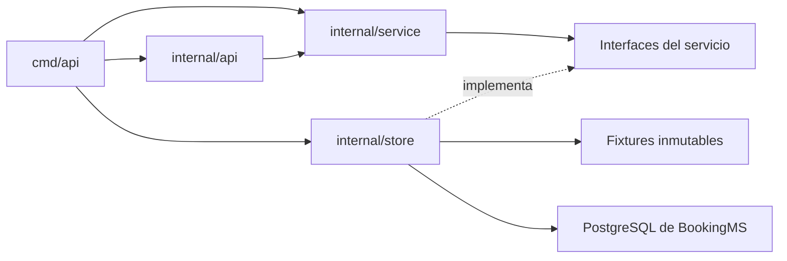

# Backend de reservas

BookingMS expone las 14 operaciones del Hito 1 con datos simulados. El ejecutable Go vive en `cmd/api` y el proceso Goose en `cmd/migrate`.

## Capas

- **Handler:** enruta, valida la entrada HTTP y traduce resultados y fallas a OpenAPI.
- **Service:** decide escenarios, filtra, pagina y recorta disponibilidades. Declara las interfaces para leer datos y consultar disponibilidad de la base.
- **Store:** carga fixtures y los ofrece por interfaces de solo lectura. Su adaptador PostgreSQL comprueba la conexión de `/readyz`.
- **Model:** contiene el modelo del dominio y los tipos de lectura de la demostración. Los paquetes internos de servicio y store importan esos tipos compartidos. El punto de entrada inyecta los adaptadores.

## Propiedad de datos y dependencias

| Dato | Responsable | Uso actual |
| --- | --- | --- |
| Reservas, horarios, bloqueos y políticas del recurso en BookingMS | BookingMS | Los fixtures simulan lecturas y respuestas de escritura. |
| Identidad, usuarios y permisos de la sección | Servicio de identidad de la sección, nombre por confirmar | Las reservas guardan una referencia al responsable. La demo usa actores simulados. |
| Datos del catálogo maestro, cuando aplique | Proveedor del catálogo, por confirmar | El contrato admite una referencia externa opcional. |
| Envío y estado de notificaciones | Proveedor de notificaciones, por confirmar | La confirmación de reserva usa un escenario local. |

El único acceso a base de datos de la demo es al PostgreSQL propio, desde el adaptador de disponibilidad y Goose. Los enlaces a proveedores se confirmarán con el documento de componentes de Civil. El código actual de la demo carece de llamadas a proveedores.

## Modelos iniciales

| Tipo | Propósito |
|---|---|
| `Resource` | Recurso exclusivo con ámbito, habilitación, zona horaria y referencia opcional al catálogo externo. |
| `Reservation` | Reserva de un único recurso, responsable, intervalo, estado, plazo aceptado y versión. |
| `IdentityReference` | Referencia externa por emisor (`Issuer`) y sujeto (`Subject`), sin duplicar perfiles ni credenciales. |
| `Interval` | Instantes de inicio y fin con semántica `[inicio, fin)`. |
| `ReservationStatus` | Estados `confirmed` y `cancelled`; sin estados pendientes ni expiración automática. |
| `CancellationPolicySnapshot` | Plazo original (`Notice`) y referencia a la versión de política aceptada al confirmar. |
| `ExternalReference` | Identificador del recurso dentro de un catálogo externo opcional. |

Los modelos no incluyen etiquetas JSON ni BSON. Los identificadores son cadenas opacas; esto no fija UUID, ObjectID ni un formato de almacenamiento. Los documentos del repositorio definirán el mapeo BSON. `Notice` es una duración Go, no una unidad ni formato público de API o almacenamiento. El servicio calculará el límite como `Interval.Start - Notice` y garantizará que el plazo aceptado no cambie.

`Attributes` contiene datos específicos del contexto; su esquema y validación se implementarán explícitamente antes de admitir escrituras. No permite cambiar estados, permisos, políticas u ocupación por medio de campos adicionales. Los mapas deben copiarse al aplicar cambios para no modificar accidentalmente la versión original.

Los campos exportados son representación de datos, no una garantía de validez. Los servicios deberán proteger responsable y plazo de cancelación, validar estados e intervalos y coordinar transacciones; `Version` por sí solo no impide escrituras concurrentes. No se añaden métodos de creación, modificación ni cancelación en esta etapa.

No se modelan todavía horarios recurrentes, excepciones, selección de políticas ni contratos de auditoría: sus detalles pendientes se mantienen en la especificación. Tampoco se crea una entidad de asignación separada, porque `Reservation.ResourceID` representa la relación uno a uno acordada.

## Verificación local

Desde `apps/api`, ejecutar `go test ./...`, `go vet ./...` y `go run ./cmd/api`. El modo Go/Vite usa la API en `127.0.0.1:4010`. Sin `DATABASE_URL`, las operaciones de la demo están disponibles y `/readyz` devuelve 503.

En Compose, la API escucha en 8080 dentro del contenedor y se publica en [5191](http://127.0.0.1:5191/healthz). Goose aplica las migraciones de `db/migrations/` previamente. Con `API_ENV=dev`, [Swagger](http://127.0.0.1:5191/api/docs) sirve el contrato.

- [Contrato OpenAPI](../../contracts/openapi.yaml)
- [Modos de falla y verificaciones](../../docs/modos-de-falla.md)
